# What Was Built in November

By [welliv](https://nostr.at/npub1626pdpr8gw0s86m7pccta9qj6k3f6pg243maccx78h9e730ervrstr3hde)

Nut November submission notes. All commit dates below are UTC from `git log`; live Mutinynet run times are `Africa/Nairobi` (EAT, UTC+3).

Picture handing an AI agent or third-party app a [Nostr Wallet Connect](https://github.com/nostr-protocol/nips/blob/master/47.md) (NIP-47) link to your Cashu wallet. Cashu ecash is bearer money: whoever holds the proofs can spend them. Most NWC setups guard your whole balance with a software counter in front of one shared wallet—which works only until a bug, race condition, or dropped relay reply lets a link reach the entire wallet.

**Don't count the money—separate it. Let the mint enforce the limit.**

In November, we built **per-connection Cashu pockets** (`cdk-nwc-pocket`), a fail-closed policy control plane (`cdk-nwc-policy`), an operator CLI (`cdk-nwc-policy-cli`), an upstream NWC forwarding handler (`cdk-nwc-forward`), and relay/wallet hardening inside `cdk-nostr` and `cdk` so every spendable link on a local CDK wallet can live inside its own mint-enforced cash envelope.

---

## The 30-second explanation

- **What was built in November:** Four new crates plus targeted hardening in `cdk-nostr`, `cdk`, and `cdk-http-client` on top of upstream `cashubtc/cdk`.
- **How pockets work:** Each `--pocket` link gets its own `cdk::Wallet` (derived seed + own SQLite DB). Funding, ceiling sweeps, and revoke sweeps are same-mint Cashu swaps—so the mint's double-spend database enforces the spend cap, not just software counters.
- **Control plane & relay resilience:** `cdk-nwc-policy` enforces method allowlists, expiry, immediate `UNAUTHORIZED` revocation, `3,600s` replay protection, and fail-closed reservations; `cdk-nostr` adds a 10,000-entry `OutcomeCache` and 4-step publish retry with reconnect so relay drops don't turn settled melts into false failures.

---

## Architecture

```mermaid
flowchart LR
    Agent["App or AI Agent<br/>(NIP-47 NWC URI)"]
    Service["NwcService (cdk-nostr)<br/>OutcomeCache + 4-step retry"]
    Policy["PolicyNwcHandler (cdk-nwc-policy)<br/>allowlist, expiry, revoke, replay"]
    Pocket["PocketNwcHandler (cdk-nwc-pocket)<br/>pocket wallet + SQLite DB (sat only)"]
    Refiller["Refiller (main-side)<br/>rolling refill cap + OutOfFunds"]
    Main["Main CDK Wallet"]
    Mint["Cashu Mint<br/>double-spend enforcement"]

    Agent <-->|"Nostr relays"| Service --> Policy --> Pocket -->|"melt / mint quote"| Mint
    Pocket -.->|"request refill"| Refiller
    Refiller -->|"same-mint swap"| Pocket
    Main <-->|"fund / sweep"| Mint
    Refiller --- Main
```



---

## Live rogue-agent proof (Mutinynet, 26 Nov 2026)

On **2026-11-26 (01:51–01:56 EAT)** we ran `cargo run -p cdk-nwc-pocket --example rogue_agent` live against `https://cashu.mutinynet.com` (`Nutshell/0.21.0`, `input_fee_ppk = 100`) over public relays (`wss://relay.primal.net`, `wss://nostr.mom`, `wss://relay.damus.io`):

- Funded main with **53 sat** (`54 sat` paid from funding wallet incl. `1 sat` LN fee); funded pocket #0 with **30 sat** (`32 sat` cost incl. `2 sat` swap fee), leaving **21 sat** in main.
- Rogue agent `get_balance` saw **30 sat** (pocket only). It paid `3 × 7 sat` (`+ 6 sat` measured fees = **27 sat** spent), even though Round 3 hit a relay drop (`OTHER "relay not connected"`—which prompted `22748501`).
- Round 4 was **cut off** (`INSUFFICIENT_BALANCE "insufficient pocket balance"`), and a **21 sat** invoice to drain main was **refused** (`INSUFFICIENT_BALANCE`).
- **Main stayed 21 → 21 sat (untouched)** during the attack. Revoke swept **2 sat** home (`0 sat` pending); returning attacker loot swapped **19 sat** back (`21 sat` minus `2 sat` fee), ending main at **42 sat** (net cost after returning `35 + 2 sat` with `1 sat` dust left: **17 sat**).

---

## Software counter vs. Cashu pocket

| Property | Software counter (without `--pocket`) | Cashu pocket (`--pocket`) |
|---|---|---|
| **Boundary** | JSON counters in `nwc-policy.json` over one shared balance | **Separate Cashu wallet & proofs per link** |
| **Enforcer** | Local application bookkeeping | **The Cashu mint** |
| **Prepaid-card guarantee** | No — ledger/bypass risk reaches whole main wallet | **Yes** — max loss is bounded by the pocket's proofs |
| **`get_balance` view** | Main wallet balance | **Pocket balance only** |
| **Revoke** | Replies `UNAUTHORIZED` | Replies `UNAUTHORIZED` **and swaps proofs home** |

---

## Quickstart

```bash
cargo run -p cdk-nwc-pocket --example rogue_agent -- \
  --mint-url https://cashu.mutinynet.com --work-dir ./rogue-demo

# Or use the operator CLI:
cargo build -p cdk-nwc-policy-cli
export CDK_NWC_SEED_HEX=<128-hex-char-seed>
./target/debug/nwc-policy-cli create --mint-url https://cashu.mutinynet.com \
  --wallet-db ./wallet.sqlite --name agent --relay wss://relay.primal.net \
  --pocket --pocket-sats 30 --refill-cap-sats 40 --refill-window 1d \
  --auto-refill-below-sats 5 --auto-refill-to-sats 20
```

---

## Honest costs and limits

- **Prepaid-card guarantee requires `--pocket`.** Shared-balance mode (without `--pocket`) and upstream forwarding (`cdk-nwc-forward`) are software counters over a shared wallet.
- **`sat` unit only; no sub-sat msat or amountless invoices.** `PocketNwcHandler` requires `CurrencyUnit::Sat` (`UnsupportedUnit` otherwise), and `WalletNwcHandler` rejects `msat % 1000 != 0` and amountless invoices.
- **Same-mint melts return `preimage: ""`.** Internal Cashu settlements return `payment_preimage: null`; CDK verifies `MeltQuoteState::Paid` with the mint and returns an empty `preimage` string.
- **`make_invoice` restrictions & claim loop.** `description_hash` and `expiry` are rejected, mint quote HTTP calls time out at 30s, and incoming payments require `serve`'s claim loop (`--claim-interval-secs`, default `10`) to mint proofs.
- **No `get_budget` over NIP-47.** `nostr` `0.45` (`0.45.3`) cannot parse `get_budget`; use `nwc-policy-cli pockets`.
- **Single OS process in `serve`.** Wallet-level isolation enforced at the mint, not OS-process isolation unless you serve the pocket DB in a separate process.
- **`nwc-policy.json` holds counters, not an audit log.** Payment history lives in each wallet's SQLite DB (`lookup_invoice` / `list_transactions`).
- **Swap fees, dust, single-mint custody, and mint linkability.** Fee-charging mints (`input_fee_ppk > 0`) charge ~1–2 sat per swap/sweep and leave dust below the melt-fee floor; pockets share mint trust and swap linkability with main.

---

## Deep details: November boundary & commit log

### Before 1 November (upstream CDK, not ours)

The work builds on upstream [cashubtc/cdk](https://github.com/cashubtc/cdk):

- `crates/cdk/src/wallet/nwc.rs` — `WalletNwcHandler`, mapping NIP-47 methods to Cashu wallet operations. Added upstream in `10cab2ab` (2026-06-24, `"feat(nwc): add NIP-47 wallet service support"`).
- `crates/cdk-nostr` — NIP-47 wallet service (`NwcService`) and the `NwcRequestHandler` trait. Added upstream in `530d3a37` (2026-08-14).
- The CDK wallet, mint, quote, melt, swap, and proof-storage code.

The last upstream `main` commit before 1 November is **`8006cc30`** (`2026-10-29 13:17:12Z`). This branch was later synced with upstream `main` at **`c1105a09`** (`2026-11-24 20:34:44Z`, merged in `c3e1fe38` on `2026-11-25`), so the diff against our upstream base is `git diff c1105a09 HEAD`. Every non-merge commit in `c1105a09..HEAD` is ours; upstream November commits by other CDK contributors came in only through that merge and are not part of this submission.

### Built in November (this submission)

Range: `73bfce13^..HEAD` on the submission branch (first commit `2026-11-24 17:35:32Z`). Against `c1105a09` before the docs/relay commits (`e6b33d28`): 55 files changed, 9,987 lines added, 50 removed.

| Commit | Date (UTC) | Change |
|---|---|---|
| `73bfce13` | 2026-11-24 17:35 | `feat(nwc-policy): add per-connection policy enforcement` |
| `02c128af` | 2026-11-25 11:21 | `docs(nwc-policy): add Nut November submission package` |
| `91a22574` | 2026-11-25 11:21 | `ci(nwc-policy): add focused checks` |
| `bc90b932` | 2026-11-25 17:11 | `docs(nwc-policy): record live signet validation` |
| `c23d147b` | 2026-11-25 17:13 | `docs(nwc-policy): add submission banner to README` |
| `38708522` | 2026-11-25 17:22 | `docs(nwc-policy): leave category choice to judges` |
| `6e5e4160` | 2026-11-25 17:29 | `docs(nwc-policy): make repo explain the idea clearly` |
| `bdfbe3c2` | 2026-11-25 18:01 | `docs(nwc-policy): record Mutinynet live validation` |
| `6f6e548c` | 2026-11-25 18:13 | `docs(nwc-policy): correct live interoperability claim` |
| `3cf0f492` | 2026-11-25 18:22 | `docs(nwc-policy): correct shared-balance interpretation` |
| `3e626dab` | 2026-11-25 18:26 | `docs: align repo with CDK contribution style` |
| `ee7f6837` | 2026-11-25 19:45 | `nwc-policy: fix rollover accounting, release on insufficient balance, claim paid invoices, CLI period/expiry flags, keep upstream error codes` |
| `3a5600c1` | 2026-11-25 20:08 | `nwc: fix input fees, preimage verification, per-connection info methods, bounded replay ledger, 0600 wallet DB, and reservation expiry` |
| `d087a065` | 2026-11-25 20:49 | `nwc: time out stalled mint HTTP so make_invoice cannot hang forever` |
| `1a995996` | 2026-11-25 21:28 | `nwc: start revoked/expired connections so they reply UNAUTHORIZED; distinguish payment cap from period budget` |
| `fb9f5510` | 2026-11-25 22:13 | `feat(nwc-pocket): add per-connection Cashu pockets for NWC links` |
| `c0380c60` | 2026-11-25 22:13 | `test(nwc-pocket): cover isolation, revoke sweep, refill window and fees` |
| `84a6226f` | 2026-11-25 22:27 | `feat(nwc-pocket): add rogue-agent demo example` |
| `990664f4` | 2026-11-25 22:35 | `feat(nwc-policy): run a connection against its own inner handler` |
| `dcca8bc6` | 2026-11-25 22:35 | `feat(nwc-policy-cli): add pocket mode` |
| `e6b33d28` | 2026-11-25 22:35 | `test(nwc-pocket): cover serve maintenance and policy over a pocket` |
| `7ce6584c` | 2026-11-25 22:38 | `docs(nwc): add NWC overview, November notes and crate READMEs` |
| `2177e77c` | 2026-11-25 22:56 | `docs(nwc): record the live Mutinynet rogue-agent demo` |
| `22748501` | 2026-11-25 23:07 | `fix(nwc): retry response publish and cache outcomes by request id` |

Subsequent documentation commits (`HEAD`) rewrite `NWC.md`, `NOVEMBER.md`, and the four crate `README.md` files around the pocket-first narrative and verified behavior.

### By component

- **`cdk-nwc-pocket` (new crate, 25 Nov):** per-connection Cashu pockets with derived seeds (`HMAC-SHA512`), same-mint funding and sweep, rolling-window refill cap with auto-refill, ceiling sweeps, pocket-only `get_balance`, measured balance-delta `fees_paid`, single `OutOfFunds` event, and `rogue_agent` demo. Commits `fb9f5510`, `c0380c60`, `84a6226f`.
- **`cdk-nwc-policy` (new crate, 24–25 Nov):** persistent `.policy.lock` JSON ledger, per-connection method allowlists, budgets, single-payment caps, fee reserves, expiry, revoke, `3,600s` replay protection, fail-closed reservations (`300s` TTL), `ConnectionManager`, and `with_inner` / `start_with_inner` to serve a connection from its own pocket. Commits `73bfce13`, `ee7f6837`, `3a5600c1`, `1a995996`, `990664f4`.
- **`cdk-nwc-policy-cli` (new crate):** `create`, `list`, `revoke`, `serve`, `fund`, `topup`, `sweep`, `pockets` (`--pocket` mode and shared/upstream modes). Commits `73bfce13`, `ee7f6837`, `3a5600c1`, `d087a065`, `dcca8bc6`.
- **`cdk-nwc-forward` (new crate):** forward NWC requests to an upstream wallet (tested against Alby Hub on Mutinynet) while preserving NIP-47 error codes. Commits `73bfce13`, `ee7f6837`.
- **Changes to upstream crates:**
  - `cdk-nostr`: `RequestContext`, per-connection advertised methods, `OutcomeCache` (`10,000` entries), and 4-step publish retry (`200ms`, `500ms`, `1s`, `2s`) with reconnect (`73bfce13`, `3a5600c1`, `22748501`);
  - `cdk/src/wallet/nwc.rs`: `fees_paid` includes swap input fees, verified empty-preimage handling on same-mint melts, sub-sat rejection, and 30s `make_invoice` timeout (`3a5600c1`, `d087a065`);
  - `cdk-http-client` and the mint HTTP connector: request timeouts so a stalled mint cannot hang `make_invoice` (`d087a065`).
- **Tests & CI:** `cdk-nwc-policy/tests/*`, `cdk-integration-tests/tests/{nwc_policy_e2e,nwc_policy_claim,nwc_policy_mutinynet_live,nwc_pocket}.rs`, `.github/workflows/nwc-policy-ci.yml`.

### Verify

```bash
git log --no-merges --format='%h %ad %an %s' --date=iso c1105a09..HEAD
git diff --stat c1105a09 HEAD
git log -1 --format='%h %ad %s' --date=iso 8006cc30   # last upstream main commit before Nov 1
```
