# Safe NWC Pockets for Cashu

By [welliv](https://nostr.at/npub1626pdpr8gw0s86m7pccta9qj6k3f6pg243maccx78h9e730ervrstr3hde)

Picture handing an AI agent—or any third-party app—the keys to spend your Cashu ecash over [Nostr Wallet Connect](https://github.com/nostr-protocol/nips/blob/master/47.md) (NIP-47).

Cashu is **bearer money**. Whoever holds the proofs can melt or swap them—just like physical cash in a wallet. That makes Cashu great for privacy, and terrifying to hand to autonomous software. A prompt-injected agent, a retry loop, a leaked connection string, or a single accounting bug can drain every sat in sight.

Today, most NWC implementations try to solve this by putting a software counter in front of one shared balance: *"this link has spent 80 of its 100-sat allowance."* That works right up until a bug, a race condition, a dropped relay reply, or a misconfiguration lets the link touch the rest of your wallet.

**Don't count the money—separate it. Let the mint enforce the limit.**

In this fork of CDK, every spendable NWC link created with `--pocket` gets its **own isolated Cashu wallet** (its own derived seed, its own SQLite database, and its own proofs) holding only what you put in front of it. Moving money into a pocket, trimming excess funds back home, and revoking a link by sweeping leftovers back to your main wallet are all cheap same-mint Cashu swaps—something Lightning channels cannot do. Even if our policy software failed completely, a 30-sat pocket cannot spend sat 31 because the mint itself will refuse to melt proofs that aren't in the pocket.

---

## The 30-second explanation

- **NWC is the remote control.** Existing Bitcoin apps and AI agent tools already speak NIP-47.
- **A pocket is a prepaid cash envelope.** Each `--pocket` link talks only to its own `cdk::Wallet`. `get_balance` shows only the pocket; `pay_invoice` can melt only the pocket's proofs.
- **The mint is the enforcer.** Even with zero software checks, the mint's double-spend database prevents a pocket from spending more than the proofs it actually holds.
- **Revoke means swap the money home.** Closing or expiring a link swaps every unspent pocket proof back into your main wallet, instantly making any copied proofs worthless at the mint.
- **Refills are capped on a rolling window.** Optional auto-refill tops a pocket up from main, bounded by a rolling cap (`--refill-cap-sats` / `--refill-window`) that cannot be doubled across midnight or month-end boundaries.
- **Hardened relay & policy layer.** A persistent fail-closed policy ledger (`cdk-nwc-policy`) plus a 10,000-entry response cache and 4-step publish retry (`cdk-nostr`) sit in front so dropped relays neither double-pay nor lie about settled payments.

---

## Architecture

```mermaid
flowchart LR
    Agent["App or AI Agent<br/>(NIP-47 NWC URI)"]
    Relays["Nostr Relays<br/>(kind 13194 / 23194 / 23195)"]
    Service["NwcService (cdk-nostr)<br/>OutcomeCache (10k) + 4-step retry"]
    Policy["PolicyNwcHandler (cdk-nwc-policy)<br/>allowlist, expiry, revoke, 3600s replay"]
    Pocket["PocketNwcHandler (cdk-nwc-pocket)<br/>pocket wallet + SQLite DB (sat only)"]
    Refiller["Refiller (main-side)<br/>rolling cap + OutOfFunds event"]
    Main["Main CDK Wallet<br/>main seed + SQLite DB"]
    Mint["Cashu Mint<br/>double-spend protection"]

    Agent <-->|"NIP-44 / NIP-04"| Relays
    Relays <--> Service
    Service --> Policy
    Policy --> Pocket
    Pocket -->|"melt / mint quote"| Mint
    Pocket -.->|"request refill"| Refiller
    Refiller -->|"same-mint swap (capped)"| Pocket
    Main <-->|"fund / ceiling sweep / revoke sweep"| Mint
    Refiller --- Main
```



---

## Live rogue-agent proof (Mutinynet, 26 Nov 2026)

We didn't leave this as a theory. We ran `rogue_agent` live against **`https://cashu.mutinynet.com`** (`Nutshell/0.21.0`, `input_fee_ppk = 100`) over public Nostr relays (`wss://relay.primal.net`, `wss://nostr.mom`, `wss://relay.damus.io`) on **2026-11-26 (01:51–01:56 EAT / UTC+3)**.

The funding wallet paid one **53 sat** mint invoice (+ **1 sat** Lightning routing fee = **54 sat** out). A **30 sat** pocket (`pocket #0`) was funded via a same-mint swap (**32 sat** total cost, leaving **21 sat** in the main wallet). Then the "rogue" agent—holding only the NWC URI—tried to drain everything to an attacker wallet on the same mint in 7 sat bites, followed by an invoice for the entire main balance:

```text
funded: main wallet holds 53 sat
pocket #0 funded with 30 sat (cost 32 sat). main: 21 sat, pocket: 30 sat
agent get_balance: 30 sat (pocket only)
round 1: agent paid 7 sat to attacker (fee 2000 msat, 18020 ms)
round 2: agent paid 7 sat to attacker (fee 2000 msat, 18016 ms)
round 3: payment failed OTHER "relay not connected"; trying a new invoice
round 4: CUT OFF: INSUFFICIENT_BALANCE "insufficient pocket balance" (18016 ms)
agent asks for 21 sat (= whole main wallet): REFUSED INSUFFICIENT_BALANCE
revoked: swept 2 sat home (0 sat pending)
```

| Check | Live Mutinynet result |
|---|---|
| Pocket funded | **30 sat** (main held **21 sat**) |
| Agent `get_balance` | **30 sat** (main balance invisible) |
| Pocket spent before cut-off | **27 sat** (`3 × 7 sat` invoices + `3 × 2 sat` mint fees) |
| Attacker wallet held | **21 sat** |
| Round 4 cut-off | **`INSUFFICIENT_BALANCE`** (`"insufficient pocket balance"`) |
| Whole-wallet drain (`21 sat`) | **Refused** (`INSUFFICIENT_BALANCE`) |
| Main wallet during attack | **21 → 21 sat (untouched)** |
| Revoke sweep to main | **2 sat** swept home (`0 sat` pending) |
| Attacker loot swapped back | **19 sat** (`21 sat` minus `2 sat` swap input fee) |
| Main wallet at end | **42 sat** (`21 + 2 + 19`) |

Notice **Round 3**: the public relay dropped before returning the kind `23195` reply (`OTHER "relay not connected"`), yet the melt had already settled on the mint (`21 sat` reached the attacker, leaving only `3 sat` in the pocket—which is why Round 4 hit `INSUFFICIENT_BALANCE`). Two things followed directly from observing that live failure:
1. The pocket still held the hard monetary boundary—Round 3 did not leak an extra sat from main.
2. We immediately added `OutcomeCache` and a 4-step publish retry with reconnect (`22748501`) in `cdk-nostr` so a relay drop after a melt retries the exact signed response instead of telling the client a paid invoice failed.

Leftover funds were returned from the demo main wallet to the funding wallet (`35 sat` + `2 sat`, `4 sat` return melt fees, `1 sat` dust left below the 2 sat melt-fee floor). Net cost across the entire live experiment—including user LN fee, funding swap, attacker melts, revoke sweep, loot return, and two return melts—was **17 sat** (`54 sat` paid out, `37 sat` returned).

We also verified `nwc-policy-cli` pocket mode through a third-party NWC client (Alby SDK `NWCClient`) over public relays against a local FakeWallet mint (`--pocket-sats 30 --refill-cap-sats 40 --auto-refill-below-sats 5 --auto-refill-to-sats 20`): six `7 sat` payments succeeded (`fees_paid: 3000 msat` each, `60 sat` total spent = `30` initial + `34` refilled − `4` left), the next six were refused with `QUOTA_EXCEEDED "pocket refill cap reached"` and one `OutOfFunds` event, and `revoke` swept `3 sat` home after which further calls returned `UNAUTHORIZED`.

---

## Software counter vs. Cashu pocket

| Property | Software counter (shared balance / without `--pocket`) | Cashu pocket (`--pocket`) |
|---|---|---|
| **Where the money sits** | One shared main wallet holding your full balance | Separate Cashu wallet per link (own derived seed + SQLite DB) |
| **What enforces the limit** | JSON counters in `nwc-policy.json` | **The Cashu mint** (proofs not in the pocket cannot be spent) |
| **Prepaid-card guarantee** | No — a ledger bug or bypass exposes the full main balance | **Yes** — max loss is bounded by the proofs inside that pocket |
| **What `get_balance` reports** | Full main wallet balance | **Pocket balance only** |
| **Window reset behavior** | Rolling or fixed-period counter (`daily`, `weekly`, `monthly` 30d, `yearly` 365d) | Rolling-window refill cap on `Refiller`; cannot double across calendar boundaries |
| **Revoke / expiry effect** | Marks `revoked = true` in `nwc-policy.json`; replies `UNAUTHORIZED` | Replies `UNAUTHORIZED` **and swaps all unspent pocket proofs back to main** |
| **Fee accounting** | Invoice + wallet-reported `fee_paid` + `swap_fee` | Measured balance drop `(before - after) - invoice_msat` |
| **Swap overhead** | None between links | ~1–2 sat swap fee per fund/refill/sweep on fee-charging mints (`input_fee_ppk > 0`) |

> **Shared-balance mode and forwarding mode remain explicit opt-ins:** Creating a link *without* `--pocket` uses `cdk-nwc-policy` as a software counter over your main CDK wallet. Using `--upstream-nwc-uri-file` uses `cdk-nwc-forward` to enforce the same policy counter in front of an external NWC wallet (such as Alby Hub). Neither mode gives pocket-level monetary isolation.

---

## Quickstart

### 1. Run the rogue-agent demo (fastest way to see it)

```bash
# Over public Nostr relays against Mutinynet (prints a signet invoice if main needs funding)
cargo run -p cdk-nwc-pocket --example rogue_agent -- \
  --mint-url https://cashu.mutinynet.com --work-dir ./rogue-demo

# Or in-process without relay latency (works with any mint, e.g. a local FakeWallet mint)
cargo run -p cdk-nwc-pocket --example rogue_agent -- \
  --mint-url http://127.0.0.1:3339 --work-dir ./rogue-demo-local --no-relay
```

### 2. Run `nwc-policy-cli` in pocket mode

```bash
cargo build -p cdk-nwc-policy-cli
alias nwc-policy-cli=./target/debug/nwc-policy-cli

# 64-byte hex seed (128 hex chars); keep it out of shell arguments and git
export CDK_NWC_SEED_HEX=<128-hex-char-seed>
W="--mint-url https://cashu.mutinynet.com --wallet-db ./wallet.sqlite"

# 1. Fund the main wallet (prints a BOLT11 invoice and waits for payment)
nwc-policy-cli fund $W --sats 200

# 2. Create a pocket link: 30 sat pocket, auto-refill to 20 when <= 5,
#    capped at 40 sats of refills per rolling 1-day window
nwc-policy-cli create $W --name agent --relay wss://relay.primal.net \
  --pocket --pocket-sats 30 --refill-cap-sats 40 --refill-window 1d \
  --auto-refill-below-sats 5 --auto-refill-to-sats 20
# Prints connection_id=<id> and nostr+walletconnect://... (treat URI as a secret)

# 3. Serve all active connections (claims paid quotes & maintains pockets every 10s)
nwc-policy-cli serve $W --network signet

# 4. Inspect pockets, manually top up, sweep, or revoke
nwc-policy-cli pockets $W
nwc-policy-cli topup $W --id <id> --sats 10   # manual; bypasses refill cap, respects ceiling
nwc-policy-cli sweep $W --id <id>
nwc-policy-cli revoke $W --id <id>           # marks revoked and sweeps pocket home
```

---

## Honest costs and limits

Read these before trusting real funds to it:

1. **The prepaid-card guarantee requires `--pocket`.** Creating a link without `--pocket` falls back to shared-balance mode (a software counter over the main wallet) where a link's `get_balance` sees the entire main wallet.
2. **Sats only—no sub-satoshi millisatoshis or amountless invoices.** NIP-47 speaks millisatoshis, but `PocketNwcHandler` requires `CurrencyUnit::Sat` (`UnsupportedUnit` otherwise) and `WalletNwcHandler` rejects sub-satoshi amounts (`msat % 1000 != 0`) rather than rounding. `1,000 msat` works; `500 msat` fails; amountless BOLT11 invoices are rejected.
3. **Same-mint melts return `preimage: ""`.** When payer and payee share a mint (such as `cashu.mutinynet.com` / Nutshell 0.21.0), the mint settles internally with `fee_reserve = 0`, state `PAID`, and `payment_preimage: null`. CDK queries the mint to confirm `MeltQuoteState::Paid` and returns an empty `preimage` string rather than fabricating one.
4. **`make_invoice` limitations and claim delay.** `WalletNwcHandler::make_invoice` rejects `description_hash` and `expiry`, times out stalled mint quote HTTP calls after 30 seconds, and incoming payments only become spendable proofs after `serve`'s background claim loop (`--claim-interval-secs`, default `10`) mints paid quotes.
5. **`get_budget` is not exposed over NIP-47.** The workspace `nostr` crate (`0.45.3`) cannot parse `get_budget`, so apps cannot query their remaining budget over NWC yet. Operators inspect pocket balances, ceilings, and remaining rolling refill allowances with `nwc-policy-cli pockets`.
6. **Wallet-level isolation in a single OS process.** `nwc-policy-cli serve` runs `Refiller` (holding the main wallet) and all `PocketNwcHandler` instances in one process. For OS-level process isolation, run a separate NWC service process that has only the pocket's SQLite DB and derived seed, and refill it from outside.
7. **`nwc-policy.json` stores counters, not an audit log.** The policy file holds connection rules, `used_msat` / `fee_overage_msat` counters, open reservations (`300s` TTL), and bounded `seen_events` (`3,600s` replay window). Per-payment history lives in each wallet's SQLite database (`lookup_invoice` and `list_transactions`, scoped to the pocket DB in pocket mode).
8. **Always-on daemon, swap fees, dust, single-mint trust, and mint linkability.** `serve` must stay online to answer requests, claim incoming invoices, and sweep expired pockets. On fee-charging mints (`input_fee_ppk > 0`), each fund, refill, excess sweep, and revoke sweep burns ~1–2 sats, and tiny balances below the melt-fee floor remain as dust (our 54-sat Mutinynet run cost 17 sats net). Pockets trust the same mint as main, and the mint sees the same-mint swaps linking main and pocket proofs.

---

## Deep details

### Crate map

| Crate | Role |
|---|---|
| [`cdk-nwc-pocket`](crates/cdk-nwc-pocket) | **New:** per-connection Cashu pockets (`derive_pocket_seed`, `transfer_to_pocket`, `PocketNwcHandler`, `PocketRegistry`, `Refiller`, `sweep_pocket`, `sweep_excess`, `OutOfFunds`). |
| [`cdk-nwc-policy`](crates/cdk-nwc-policy) | **New:** persistent `.policy.lock` + `0600` atomic JSON ledger, method allowlists, expiry, revoke, `3,600s` replay dedupe, fail-closed reservations, `ConnectionManager`. |
| [`cdk-nwc-policy-cli`](crates/cdk-nwc-policy-cli) | **New:** `nwc-policy-cli` binary (`fund`, `create`, `list`, `revoke`, `serve`, `topup`, `sweep`, `pockets`). |
| [`cdk-nwc-forward`](crates/cdk-nwc-forward) | **New:** `ForwardingNwcHandler` to proxy NWC requests to an upstream NWC wallet while preserving NIP-47 error codes. |
| [`cdk-nostr`](crates/cdk-nostr) *(extended)* | `RequestContext`, per-connection filtered `get_info` / kind `13194`, `OutcomeCache` (`10,000` entries), and 4-step publish retry (`200ms`, `500ms`, `1s`, `2s`) with reconnect. |
| [`cdk`](crates/cdk/src/wallet/nwc.rs) *(extended)* | `WalletNwcHandler` swap-fee accounting, verified empty-preimage handling on same-mint `PAID` melts, sub-sat rejection, and 30s `make_invoice` timeout. |

### How pockets stay recoverable, bounded, and revocable

- **Deterministic, recoverable seeds:** Each pocket derives `HMAC-SHA512(main_seed, "cdk-nwc-pocket-v1" || index_be)`. Indexes are monotonically allocated and never reused. If a pocket database is lost, the main wallet can recompute the seed and restore unspent proofs via NUT-13—while a pocket-only process cannot invert HMAC to reach the main seed.
- **Rolling-window refill cap (`Refiller`):** Unlike calendar-day or calendar-month limits—which let an attacker spend `2×` across `23:59`–`00:01`—`PocketRegistry` tracks every refill grant with its exact timestamp and fee margin (`3,000 msat` margin reserved during transfer, then settled to actual `cost`). In any sliding `window_secs`, total refills leaving main cannot exceed `cap_msat`.
- **Single `OutOfFunds` event:** Rather than spamming 80% threshold warnings, `PocketNwcHandler` emits one `PocketEvent::OutOfFunds` (`RefillCapReached`, `NoAutoRefill`, or `CeilingReached`) at the exact moment a payment is refused and no refill is possible.
- **Ceiling sweeps (`sweep_excess`):** If a pocket receives funds via `make_invoice` above `ceiling_msat` (default `max(pocket_sats, auto_refill_to_sats, 1)`), `serve`'s maintenance pass swaps the excess back to main.
- **Revoke-by-swap (`sweep_pocket`):** Revoking or expiring a link swaps every unspent proof in the pocket back to main and calls `check_proofs_spent` on the pocket. Any copied proofs become invalid at the mint. Pending or reserved proofs are treated as spent (`pending_msat`) until resolved, then picked up by a later sweep.
- **Measured balance-delta fees:** `PocketNwcHandler` serializes `pay_invoice` calls per pocket and sets `fees_paid = (before - after) - invoice_msat`, capturing melt fees, input fees, and unreturned fee reserve.

### How the policy and relay layers harden every call

- **Fail-closed reservations:** Before dispatching `pay_invoice`, `PolicyNwcHandler` reserves `invoice_msat + max_fee_reserve_msat`. Only `InsufficientBalance` and `QuotaExceeded` (proof that nothing was dispatched) release the reservation; ambiguous failures (`PaymentFailed`, `Internal`, `Other`) keep the reservation charged (`300s` TTL) so uncertain failures cannot leak extra budget.
- **Always-on `UNAUTHORIZED` on revoke/expiry:** `ConnectionManager` starts revoked/expired connections so callers receive an immediate `UNAUTHORIZED` instead of hanging until client timeout.
- **Relay outcome cache & publish retry:** `NwcService` tracks up to `10,000` recent request event IDs in `OutcomeCache` (`InFlight` vs `Done`). If a relay drops after the handler finishes, `send_response` signs the kind `23195` event once and retries publishing across `[200ms, 500ms, 1s, 2s]` with `reconnect()`. Re-delivered requests republish the cached outcome without calling the handler twice.

### Tests

```bash
cargo test -p cdk-nwc-pocket -p cdk-nwc-policy -p cdk-nwc-policy-cli -p cdk-nwc-forward -p cdk-nostr
cargo test -p cdk-integration-tests --test nwc_pocket
cargo test -p cdk-integration-tests --test nwc_policy_claim
cargo test -p cdk-integration-tests --test nwc_policy_e2e
```

### License and attribution

Licensed under `Apache-2.0 OR MIT`, at your option, matching upstream CDK ([LICENSE.md](LICENSE.md), [LICENSE-MIT](LICENSE-MIT), [LICENSE-APACHE](LICENSE-APACHE)).

See [NOVEMBER.md](NOVEMBER.md) for the exact commit boundary separating upstream CDK from our Nut November work, and [NWC_POLICY_MANAGER_CLI.md](NWC_POLICY_MANAGER_CLI.md) for the full flag-by-flag CLI reference.
