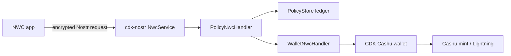

# CDK NWC Policy Layer — Nut November Submission

## One-line description

A policy layer that turns any CDK Cashu wallet into a safe NWC wallet service for real apps.

## Categories

Every project is considered for every category. We are not directing judges toward a category; the choice is theirs.

## Why it matters

NWC is how many Nostr and Lightning apps connect to wallets. Cashu wallets could already speak NWC, but they had no serious delegated-spend safety layer. This project adds per-connection budgets, method allowlists, fee reserves, expiry, revocation and durable replay protection, so an app can use ecash without receiving raw tokens or unlimited wallet access.

## Architecture

## What was built in November

- `cdk-nwc-policy`: `PolicyStore` and `PolicyNwcHandler`.
- `cdk-nwc-forward`: upstream NWC forwarding handler.
- `cdk-nwc-policy-cli`: create/list/revoke/serve lifecycle with redacted views.
- Context-aware NWC handler/service support in `cdk-nostr`.
- End-to-end policy tests, replay-after-restart coverage and live-test harness.
- Documentation: manager CLI guide, e2e guide, live-test guide, fact check and final audit.

## What existed before

The baseline was upstream CDK's NIP-47 transport, `WalletNwcHandler` mapping NWC methods to Cashu mint/melt operations, and the underlying CDK wallet/mint engine.

The November work is the per-connection policy, forwarding and operator tooling layer around that baseline. The exact November delta is in [docs/nwc-policy/NOVEMBER_DELTA.md](docs/nwc-policy/NOVEMBER_DELTA.md).

## Key capabilities

- Budget in millisatoshis, with single-payment cap and fee reserve.
- Method allowlist per connection.
- Revocation and expiry.
- Persistent event-replay ledger.
- Redacted CLI connection listings.
- Locked, permissioned manager files.
- Upstream NWC forwarding backend.

## Verification

Live signet validation completed against two Alby Hub Cashu NWC connections, including a real 1,000 msat payment through our policy layer. See [docs/nwc-policy/TEST_EVIDENCE.md](docs/nwc-policy/TEST_EVIDENCE.md).

## Limitations

- No CWC-specific methods are included here.
- No NWA, notifications, hold invoices, BOLT12 or BIP-321 extensions.
- Live network tests remain ignored by default.
- Postgres and full regtest suites are not run in this submission environment.
