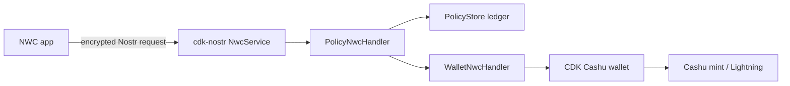

# NWC for Cashu: delegated spending with guardrails

Most wallet integrations force a bad choice: give an app broad access, or don't support it at all. This project adds a middle path for Cashu wallets.

An app gets a normal NWC connection. The user keeps the wallet, the ecash proofs, and the rules.

## The idea in one line

**NWC is the language apps already speak. Cashu is the money. This project is the seatbelt.**

A Nostr client, agent, or bot can ask a Cashu-backed wallet to check balance, create an invoice, or pay an invoice. It cannot see raw ecash tokens, mint URLs, or wallet keys. It can only do what its connection allows.

## Why this matters

Cashu ecash is powerful because it is private, offline-capable, and mint-backed. But those same properties make casual remote access dangerous.

A raw Cashu token is bearer money. If an app receives the token, it owns the money.

NWC does not expose tokens. It exposes a small, familiar command set. That makes it the right first bridge between real apps and Cashu wallets — provided the bridge has real policy around it.

This project adds that policy:

- per-app budgets;
- method allowlists;
- fee reserves;
- expiry;
- revocation;
- replay protection;
- durable accounting.

## How it works

The app sees a normal NWC wallet. Internally, CDK maps NWC methods to Cashu operations:

| App asks for | Wallet does |
|---|---|
| `get_balance` | Reads ecash balance and reports millisatoshis |
| `make_invoice` | Creates a Cashu mint quote |
| `pay_invoice` | Creates a melt quote and burns ecash to pay Lightning |
| `lookup_invoice` | Looks up mint/melt quote state |
| `list_transactions` | Reads CDK transaction history |

## What the user actually gets

- Existing NWC apps can use a Cashu wallet without native Cashu support.
- Apps never receive bearer ecash proofs.
- Each app connection can be capped and revoked.
- Budgets are enforced before money moves.
- Replayed events cannot cause a second spend.
- Operator listings redact secrets.

## What was built in November

- `cdk-nwc-policy`: ledger and handler for per-connection enforcement.
- `cdk-nwc-forward`: upstream NWC forwarding backend.
- `cdk-nwc-policy-cli`: create/list/revoke/serve with redacted views.
- Context-aware request handling in `cdk-nostr`.
- E2E and live-test harnesses.
- Fact check, audit, and operator documentation.

The pre-existing baseline was upstream CDK's NIP-47 service and `WalletNwcHandler`. The November delta is documented in [NOVEMBER_DELTA.md](docs/nwc-policy/NOVEMBER_DELTA.md).

## Live proof

We validated against two signet Alby Hub Cashu NWC connections:

- discovery, balance, and history worked;
- method filtering rejected a non-allowlisted method;
- a 1,000 msat signet payment succeeded through our policy layer;
- the ledger recorded exactly 1,000 msat used, with no open reservations.

See [TEST_EVIDENCE.md](docs/nwc-policy/TEST_EVIDENCE.md).

## Explore

- [Plain-language walkthrough](docs/nwc-policy/EXPLAINER.md)
- [Demo and reproduction steps](docs/nwc-policy/DEMO.md)
- [Live Mutinynet evidence](docs/nwc-policy/MUTINYNET_LIVE_EVIDENCE.md)
- [Test evidence](docs/nwc-policy/TEST_EVIDENCE.md)
- [November delta](docs/nwc-policy/NOVEMBER_DELTA.md)
- [Manager CLI guide](NWC_POLICY_MANAGER_CLI.md)
- [Final audit](FINAL_AUDIT.md)

## Boundaries

This submission does not include CWC-specific methods, NWA, notifications, hold invoices, BOLT12, or BIP-321. It is intentionally focused on making NWC delegation for Cashu wallets safe and usable.
