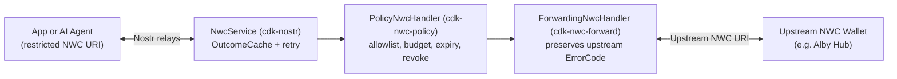

# cdk-nwc-forward

By [welliv](https://nostr.at/npub1626pdpr8gw0s86m7pccta9qj6k3f6pg243maccx78h9e730ervrstr3hde)

Give an AI agent or app a [Nostr Wallet Connect](https://github.com/nostr-protocol/nips/blob/master/47.md) (NIP-47) link to your wallet, and anyone holding that URI can ask the wallet to pay. For Cashu wallets you control locally with CDK, our first-principles answer is: **don't count the money—separate it; let the mint enforce the limit** using per-connection Cashu pockets (`cdk-nwc-pocket`).

When your funds already sit in an **upstream NWC wallet** you don't run inside CDK (such as Alby Hub), you can't split the remote wallet into Cashu pockets—but you still shouldn't hand an agent an unrestricted master URI. **`cdk-nwc-forward`** implements `NwcRequestHandler` over an upstream NWC connection so `cdk-nwc-policy` can sit in front of it as a fail-closed policy proxy (and so Rust clients/demos can speak NIP-47 cleanly while preserving exact error codes).

---

## The 30-second explanation

- **Policy proxy for any upstream NWC wallet:** `ForwardingNwcHandler` forwards `get_info`, `get_balance`, `make_invoice`, `pay_invoice`, `lookup_invoice`, and `list_transactions` to an upstream `nostr+walletconnect://` URI.
- **Preserves error codes for fail-closed accounting:** `upstream_error_from_message` recovers the upstream NIP-47 `ErrorCode` (`InsufficientBalance`, `QuotaExceeded`, `PaymentFailed`, `Internal`, etc.). That lets `PolicyNwcHandler` safely release budget only when the upstream wallet proves nothing was spent (`InsufficientBalance` / `QuotaExceeded`), while keeping ambiguous errors and timeouts (`Other`) charged.
- **Also used as the NWC client in `rogue_agent`:** In our live Mutinynet proof, the rogue agent used `ForwardingNwcHandler` over public Nostr relays to attack a pocket-backed `NwcService`.

---

## Architecture



---

## Software counter (forwarding) vs. Cashu pocket

| Property | `cdk-nwc-forward` + `cdk-nwc-policy` | `cdk-nwc-pocket` (`--pocket`) |
|---|---|---|
| **Where the money sits** | Remote upstream NWC wallet | **Local isolated Cashu pocket per link** |
| **Enforcer** | Software counter in `nwc-policy.json` | **The Cashu mint** (proof-level double-spend check) |
| **Prepaid-card guarantee** | **No** — upstream wallet holds the full balance | **Yes** — max loss is the pocket's proofs |
| **`get_balance` view** | Upstream wallet's full balance | **Pocket balance only** |
| **Note on Alby Hub Cashu** | Alby Hub's `isolated=true` sub-wallets exclude its Cashu backend | Each CDK pocket is a real separate Cashu wallet |

---

## Live Mutinynet proof context (26 Nov 2026)

`ForwardingNwcHandler` was tested in two roles during validation:
1. **Upstream proxy (`nwc-policy-cli --upstream-nwc-uri-file ...`):** Verified against Alby Hub's Cashu backend on Mutinynet (`outputs are pending [Internal]` mapped cleanly to `ErrorCode::Internal` so the policy layer failed closed instead of leaking budget).
2. **Rogue-agent client (`rogue_agent` on `https://cashu.mutinynet.com`):** Connected over `wss://relay.primal.net`, `wss://nostr.mom`, `wss://relay.damus.io` to a **30 sat** pocket while **21 sat** sat in main. Paid `3 × 7 sat` (`+ 6 sat` fees = `27 sat`), observed Round 3 relay drop (`OTHER "relay not connected"`), hit `INSUFFICIENT_BALANCE` at Round 4, was refused on a `21 sat` whole-wallet drain (`main` stayed `21 → 21 sat`), and saw `2 sat` swept home + `19 sat` loot returned (`17 sat` net cost after returning `35 + 2 sat`).

---

## Quickstart

### In Rust

```rust,no_run
use std::sync::Arc;
use std::time::Duration;
use cdk_nwc_forward::ForwardingNwcHandler;
use cdk_nwc_policy::PolicyNwcHandler;

# fn example(upstream_uri: &str) -> Result<(), Box<dyn std::error::Error>> {
let upstream = ForwardingNwcHandler::from_uri(upstream_uri, Duration::from_secs(30))?;
let policy_handler = PolicyNwcHandler::new("nwc-policy.json", Arc::new(upstream))?;
# let _ = policy_handler;
# Ok(())
# }
```

### With `nwc-policy-cli`

```bash
# Keep the upstream NWC URI in a 0600 file, never on the command line
nwc-policy-cli --upstream-nwc-uri-file /path/to/alby-nwc.uri \
  --manager nwc-manager.json --policy nwc-policy.json \
  create --name "Alby app" --relay wss://relay.primal.net \
  --budget-msat 10000 --single-cap-msat 8000 \
  --methods get_info,get_balance,pay_invoice --fee-reserve-msat 100

nwc-policy-cli --upstream-nwc-uri-file /path/to/alby-nwc.uri \
  --manager nwc-manager.json --policy nwc-policy.json serve
```

---

## Honest costs and limits

- **Software-counter isolation only.** Forwarding does not create Cashu pockets; a bug or bypass in `nwc-policy.json` (or direct use of the upstream URI) exposes the upstream wallet. For mint-enforced pockets, use a local CDK wallet with `cdk-nwc-pocket` (`--pocket`).
- **Two relay hops.** Requests travel `App -> NwcService -> ForwardingNwcHandler -> Upstream Wallet`, adding latency and relay failure surface.
- **Network/transport timeouts fail closed.** If the upstream response times out or drops without a trailing `[ErrorCode]`, `upstream_error_from_message` returns `ErrorCode::Other`, so `PolicyNwcHandler` keeps the reservation charged (`300s` TTL) instead of risking a free retry.
- **No `get_budget`.** `nostr` / `nwc` `0.45` cannot parse `get_budget`.
- **Policy file stores counters, not an audit log.** `nwc-policy.json` records budgets and open reservations; transaction history remains on the upstream wallet.

---

## Deep details

`nwc` (`0.45`) flattens wallet errors into `"<message> [<ErrorCode>]"`. `upstream_error_from_message` inspects only the trailing ` [<ErrorCode>]` suffix across the 10 NIP-47 error codes (`RateLimited`, `NotImplemented`, `InsufficientBalance`, `PaymentFailed`, `NotFound`, `QuotaExceeded`, `Restricted`, `Unauthorized`, `Internal`, `Other`), strips it into `NIP47Error`, and leaves unparseable strings or transport failures (`timeout [Bogus]`, `response not received`, etc.) as `ErrorCode::Other`.

### Tests

```bash
cargo test -p cdk-nwc-forward
```

## License

`Apache-2.0 OR MIT`, at your option, matching CDK.
