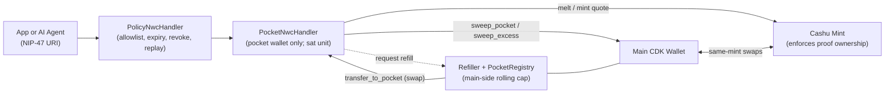

# cdk-nwc-pocket

By [welliv](https://nostr.at/npub1626pdpr8gw0s86m7pccta9qj6k3f6pg243maccx78h9e730ervrstr3hde)

Give an AI agent or third-party app a [Nostr Wallet Connect](https://github.com/nostr-protocol/nips/blob/master/47.md) (NIP-47) link to your Cashu wallet, and you have a bearer-cash problem: whoever holds the proofs can spend them. Most NWC setups guard your money with a software counter in front of one shared balance—which only holds until a ledger bug, a race, a lost relay reply, or a bad config lets the link reach everything else.

**Don't count the money—separate it. Let the mint enforce the limit.**

`cdk-nwc-pocket` gives every spendable NWC link its **own** Cashu wallet (`cdk::Wallet`, derived seed, and SQLite database). Funding, ceiling sweeps, and revocations are same-mint Cashu swaps—no Lightning round-trip required. Even if our software has a bug, a 30-sat pocket cannot lose sat 31 because the mint itself refuses to spend proofs that aren't in the pocket.

---

## The 30-second explanation

- **One pocket per link:** `PocketNwcHandler` holds *only* the pocket wallet, never the main wallet. `get_balance` reports only the pocket.
- **Mint-enforced cap:** The mint's double-spend database is the real boundary, not a counter in memory or JSON.
- **Recoverable from main:** `derive_pocket_seed` uses `HMAC-SHA512(main_seed, "cdk-nwc-pocket-v1" || index_be)`, so main can always restore pockets (NUT-13) while a pocket cannot derive main.
- **Rolling refill cap:** `Refiller` enforces `cap_msat` per rolling `window_secs` on the main-wallet side (no calendar-boundary `2×` loophole) and emits one `PocketEvent::OutOfFunds` when dry.
- **Revoke-by-swap:** `sweep_pocket` swaps all unspent pocket proofs back to main and marks them spent at the mint, invalidating any copied proofs.

---

## Architecture



---

## Live rogue-agent proof (Mutinynet, 26 Nov 2026)

Tested live with `cargo run -p cdk-nwc-pocket --example rogue_agent` against `https://cashu.mutinynet.com` (`Nutshell/0.21.0`, `input_fee_ppk = 100`) over public Nostr relays (`wss://relay.primal.net`, `wss://nostr.mom`, `wss://relay.damus.io`):

1. Main wallet funded with **53 sat** (`54 sat` paid from funding wallet incl. `1 sat` LN fee).
2. Pocket #0 funded with **30 sat** (`32 sat` cost incl. `2 sat` swap fee); main held **21 sat**.
3. Rogue agent `get_balance` saw **30 sat** (pocket only) and started paying `7 sat` invoices to an attacker wallet on the same mint:
   - Round 1: paid `7 sat` (`2,000 msat` measured fee)
   - Round 2: paid `7 sat` (`2,000 msat` measured fee)
   - Round 3: relay dropped the NWC reply (`OTHER "relay not connected"`), but the melt settled on-mint (`7 sat` + `2 sat` fee) -> **27 sat** total spent from pocket, **21 sat** held by attacker
   - Round 4: **CUT OFF** with `INSUFFICIENT_BALANCE "insufficient pocket balance"`
4. Agent requested **21 sat** (the entire main wallet): **REFUSED** (`INSUFFICIENT_BALANCE`).
5. **Main stayed 21 → 21 sat (untouched)** throughout the attack.
6. Revoke swept **2 sat** home (`0 sat` pending); returning attacker loot swapped **19 sat** back (`21 sat` minus `2 sat` input fee), leaving main at **42 sat**. Net cost after returning funds to the funding wallet (`35 + 2 sat`, `4 sat` return fees, `1 sat` dust): **17 sat**.

---

## Software counter vs. Cashu pocket

| Property | Software counter (shared main balance) | `cdk-nwc-pocket` |
|---|---|---|
| **Boundary** | JSON counter in front of main wallet | **Separate Cashu wallet & proofs per link** |
| **Enforcer** | Local application logic | **The Cashu mint** |
| **Max loss on ledger bug** | Up to entire main balance | **At most what is inside that pocket** |
| **`get_balance` view** | Main wallet balance | **Pocket balance only** |
| **Revoke** | Denies future requests in software | Denies requests **and swaps proofs back to main** |
| **Cost per transfer** | `0` | Same-mint swap input fee (~1–2 sat on `input_fee_ppk > 0`) |

---

## Quickstart

### Run the included `rogue_agent` demo

```bash
# Public relays + Mutinynet (prints a signet faucet invoice if main needs funding)
cargo run -p cdk-nwc-pocket --example rogue_agent -- \
  --mint-url https://cashu.mutinynet.com --work-dir ./rogue-demo

# Local in-process run without relay latency
cargo run -p cdk-nwc-pocket --example rogue_agent -- \
  --mint-url http://127.0.0.1:3339 --work-dir ./rogue-demo-local --no-relay
```

### Use in Rust

```rust,no_run
use std::sync::Arc;
use cdk::Amount;
use cdk_nwc_pocket::{
    derive_pocket_seed, sweep_pocket, transfer_to_pocket, AutoRefill, PocketConfig,
    PocketNwcHandler, PocketRegistry, RefillPolicy, Refiller, MSAT_PER_SAT,
};

# async fn example(main: Arc<cdk::Wallet>, pocket: Arc<cdk::Wallet>) -> Result<(), cdk_nwc_pocket::Error> {
let registry = PocketRegistry::new("nwc-policy.pockets.json")?;
registry.add(PocketConfig {
    connection_id: "agent-1".to_owned(),
    index: 0,
    ceiling_msat: 30 * MSAT_PER_SAT,
    refill: RefillPolicy {
        cap_msat: 40 * MSAT_PER_SAT,
        window_secs: 86_400,
        auto_refill: Some(AutoRefill {
            threshold_msat: 5 * MSAT_PER_SAT,
            target_msat: 20 * MSAT_PER_SAT,
        }),
    },
    swept_at: None,
})?;

transfer_to_pocket(&main, &pocket, Amount::from(30), None).await?;
let refiller = Arc::new(Refiller::new(Arc::clone(&main), registry));
let handler = PocketNwcHandler::new("agent-1".to_owned(), pocket.clone(), Some(refiller))?;

// Later, on revoke or expiry:
let report = sweep_pocket(&pocket, &main).await?;
# let _ = (handler, report);
# Ok(())
# }
```

To enforce method allowlists, expiry, revoke (`UNAUTHORIZED`), and `3,600s` replay protection in front of a pocket, wrap `Arc::new(handler)` with `PolicyNwcHandler::with_inner` from `cdk-nwc-policy` (or pass `--pocket` in `nwc-policy-cli`).

---

## Honest costs and limits

- **Prepaid-card guarantee applies only in pocket mode (`--pocket`).** Shared-balance mode in `cdk-nwc-policy` is a software counter over the main wallet.
- **`sat` unit only; no sub-sat msat or amountless invoices.** `PocketNwcHandler` rejects non-`Sat` wallets with `UnsupportedUnit`, and `WalletNwcHandler` rejects `msat % 1000 != 0` (`1,000 msat` works; `500 msat` fails) as well as amountless invoices.
- **Same-mint melts return `preimage: ""`.** Internal Cashu melts settle as `PAID` with `payment_preimage: null`; CDK verifies settlement with the mint and returns an empty `preimage` string.
- **`make_invoice` restrictions:** `description_hash` and `expiry` are rejected, mint quote calls time out after 30s, and incoming quotes must be claimed by a background loop (`claim_and_rebalance` / `serve --claim-interval-secs`) before the pocket can spend them.
- **No `get_budget` over NIP-47:** `nostr` `0.45` cannot parse `get_budget`; inspect remaining refill allowance via `PocketRegistry` or `nwc-policy-cli pockets`.
- **Same-process vs. OS isolation:** When `Refiller` and `PocketNwcHandler` run in one process, isolation is at the wallet/mint level, not OS process level. For process isolation, serve only the pocket DB + derived seed in its own process and refill externally.
- **Swap fees, dust, single-mint custody, and linkability:** Fee-charging mints (`input_fee_ppk > 0`) charge ~1–2 sats per fund/refill/sweep and leave balances below the melt-fee floor as dust. Pockets share custody trust with main, and the mint sees same-mint transfers linking main and pocket proofs.

---

## Deep details

| Piece | What it does |
|---|---|
| `derive_pocket_seed` | `HMAC-SHA512(main_seed, "cdk-nwc-pocket-v1" \|\| index_be)`; NUT-13 recoverable from main, indexes never reused. |
| `transfer_to_pocket` | Same-mint send/receive (`include_fee: true`); shrinks amount up to 4 tries if `cost > max_cost`, reclaiming token on receive failure. |
| `PocketNwcHandler` | Serializes payments per pocket; sets `fees_paid = (before - after) - invoice_msat`; triggers `Refiller` on `InsufficientBalance` or post-payment below threshold. |
| `PocketRegistry` | Sidecar-locked (`.pockets.lock`), atomic JSON registry storing `PocketConfig` and timestamped refill `Grant`s (IDs start at 1). |
| `Refiller` | Enforces rolling `cap_msat / window_secs` on the main-wallet side (reserving a `3,000 msat` fee margin before settling actual cost) and broadcasts `PocketEvent::OutOfFunds`. |
| `sweep_pocket` | Swaps all unspent pocket proofs to `main` and runs `check_proofs_spent`; pending/reserved proofs stay in `pending_msat` (pending-as-spent) for a later sweep. |
| `sweep_excess` | Moves pocket funds above `ceiling_msat` back to `main`. |

### Tests

```bash
cargo test -p cdk-nwc-pocket
cargo test -p cdk-integration-tests --test nwc_pocket
```

## License

`Apache-2.0 OR MIT`, at your option, matching CDK.
