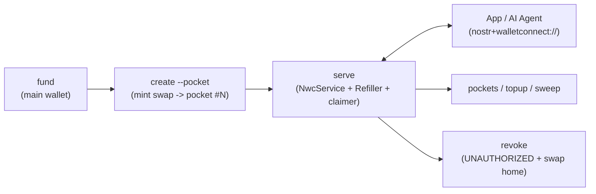

# cdk-nwc-policy-cli

By [welliv](https://nostr.at/npub1626pdpr8gw0s86m7pccta9qj6k3f6pg243maccx78h9e730ervrstr3hde)

Handing an AI agent or app a [Nostr Wallet Connect](https://github.com/nostr-protocol/nips/blob/master/47.md) (NIP-47) URI means handing over a bearer credential. Put a software counter in front of a shared balance, and one accounting bug or race condition exposes your whole wallet.

**Don't count the money—separate it. Let the mint enforce the limit.**

`nwc-policy-cli` is the operator CLI for creating, funding, serving, inspecting, topping up, sweeping, and revoking NWC links. Pass `--pocket` on `create`, and each link gets its **own isolated Cashu wallet** (`cdk-nwc-pocket`) backed by its own derived seed and SQLite database—so the Cashu mint itself caps what that link can spend.

---

## The 30-second explanation

- **`fund`** prints a BOLT11 mint invoice for your main wallet and waits until it is paid.
- **`create --pocket`** creates an NWC link with its own pocket wallet, optional rolling-window auto-refill, and a balance ceiling.
- **`serve`** runs every active link over Nostr relays, claims paid incoming `make_invoice` quotes (every `--claim-interval-secs`, default `10`), sweeps revoked/expired pockets home, trims funds above ceiling back to main, and prints `pocket event: {...}` lines.
- **`pockets` / `topup` / `sweep` / `revoke`** let you inspect pocket balances and remaining refill allowance, move sats in or out, and revoke + sweep a link home.

---

## Lifecycle



---

## Live rogue-agent proof (Mutinynet, 26 Nov 2026)

Both the `rogue_agent` pocket demo and CLI pocket mode were verified live over public relays (`wss://relay.primal.net`, `wss://nostr.mom`, `wss://relay.damus.io`):

- **Mutinynet (`https://cashu.mutinynet.com`, `Nutshell/0.21.0`, `input_fee_ppk = 100`):** Funded main with **53 sat** (`54 sat` paid incl. `1 sat` LN fee); funded a **30 sat** pocket (`32 sat` cost, leaving **21 sat** in main). Rogue agent paid `3 × 7 sat` (`+ 6 sat` fees = **27 sat** spent, even with Round 3 hitting a relay drop), got cut off on Round 4 (`INSUFFICIENT_BALANCE`), tried to drain **21 sat** from main and was refused, while **main stayed 21 → 21 sat (untouched)**. Revoke swept **2 sat** home; loot swap returned **19 sat**; net cost after returning `35 + 2 sat` was **17 sat**.
- **CLI pocket mode with Alby SDK `NWCClient`:** `create --pocket --pocket-sats 30 --refill-cap-sats 40 --refill-window 1d --auto-refill-below-sats 5 --auto-refill-to-sats 20` then `serve`: `get_balance` returned `30,000 msat`; six `7 sat` payments succeeded (`60 sat` spent = `30` initial + `34` refilled − `4` left); the next six hit `QUOTA_EXCEEDED "pocket refill cap reached"` with `OutOfFunds`; `revoke` swept `3 sat` home and subsequent calls received `UNAUTHORIZED`.

---

## Modes compared

| Mode | Command shape | Boundary | Best for |
|---|---|---|---|
| **Pocket mode (recommended)** | `create --pocket ...` | **Mint-enforced** separate Cashu wallet per link | AI agents, untrusted apps, prepaid allowances |
| **Shared-balance mode** | `create` (no `--pocket`) | **Software counter** (`--budget-msat`, `--single-cap-msat`) over main wallet | Read-only links (`--methods get_info,get_balance`) or explicit shared opt-in |
| **Upstream proxy mode** | `--upstream-nwc-uri-file <path>` | **Software counter** forwarding to an external NWC wallet | Adding allowlists/budgets/expiry in front of Alby Hub or another NWC wallet |

---

## Quickstart

```bash
cargo build -p cdk-nwc-policy-cli
alias nwc-policy-cli=./target/debug/nwc-policy-cli

# 64-byte hex seed (128 hex chars); prefer env var over --seed-hex
export CDK_NWC_SEED_HEX=<128-hex-char-seed>
W="--mint-url https://cashu.mutinynet.com --wallet-db ./wallet.sqlite"

# 1. Fund main wallet
nwc-policy-cli fund $W --sats 200

# 2. Create a pocket link (30 sat pocket, auto-refill to 20 when <= 5, max 40 sat/day)
nwc-policy-cli create $W --name agent --relay wss://relay.primal.net \
  --pocket --pocket-sats 30 --refill-cap-sats 40 --refill-window 1d \
  --auto-refill-below-sats 5 --auto-refill-to-sats 20

# 3. Serve all active connections
nwc-policy-cli serve $W --network signet

# 4. Inspect, top up, sweep, list, or revoke
nwc-policy-cli pockets $W
nwc-policy-cli topup $W --id <id> --sats 10
nwc-policy-cli sweep $W --id <id>
nwc-policy-cli revoke $W --id <id>
nwc-policy-cli list
```

---

## Honest costs and limits

- **Prepaid-card guarantee applies only with `--pocket`.** Omitting `--pocket` creates a shared-balance link guarded only by a software counter in `nwc-policy.json`, where `get_balance` exposes the main wallet balance.
- **Sats only, no sub-sat msat, no amountless invoices.** Pocket wallets require `sat`; `msat % 1000 != 0` and amountless BOLT11 invoices are rejected.
- **Same-mint melts return `preimage: ""`.** Internal melts on the same mint settle without a Lightning preimage; CDK verifies `MeltQuoteState::Paid` and returns an empty `preimage`.
- **`make_invoice` limitations & claim loop.** `description_hash` and `expiry` are rejected, mint quote HTTP calls time out at 30s, and incoming payments are only minted into proofs while `serve` runs its claim loop (`--claim-interval-secs`, default `10`).
- **No `get_budget` over NIP-47.** `nostr` `0.45` cannot parse `get_budget`; use `nwc-policy-cli pockets $W` to see pocket balances, ceilings, and `refill_remaining_msat`.
- **Single-process serving.** `serve` holds both the main wallet (`Refiller`) and pocket wallets in one OS process (wallet/mint isolation, not OS-process isolation).
- **Policy file is counters, not an audit log.** `nwc-policy.json` tracks counters, reservations, and replay IDs; payment history lives in each wallet's SQLite DB (`wallet.sqlite` and `wallet.sqlite.pocket-<index>.sqlite`).
- **Swap fees & dust.** On fee-charging mints (`input_fee_ppk > 0`), funding, auto-refills, and sweeps pay input fees (~1–2 sat), and tiny balances below the melt-fee floor remain as dust.

---

## Deep details

### Top-level options

- `--manager <PATH>` (default `nwc-manager.json`) — connection keys/relays store
- `--policy <PATH>` (default `nwc-policy.json`) — policy counters, reservations, replay cache (must differ from `--manager`)
- `--pockets <PATH>` (default `<policy>.pockets.json`) — pocket registry & rolling refill grants
- `--upstream-nwc-uri-file <PATH>` — forward to an upstream NWC URI instead of opening a local CDK wallet (incompatible with `--pocket`)

### Verified subcommands & key flags

| Command | Key flags (verified against `src/main.rs`) | Notes |
|---|---|---|
| `fund` | `--mint-url`, `--wallet-db`, `--sats`, `--wait-secs` (default `600`) | Polls every 3s until minted |
| `create` | `--name`, `--relay` (repeatable), `--methods` (default `get_info,get_balance,pay_invoice`), `--fee-reserve-msat` (`100`), `--expires-at` / `--expires-in` (`30m`, `12h`, `7d`, `2w`, `90s`, `3600`) | With `--pocket`: `--pocket-sats`, `--ceiling-sats`, `--refill-cap-sats`, `--refill-window` (`1d`), `--auto-refill-below-sats`, `--auto-refill-to-sats` (both required together + `--refill-cap-sats > 0`; ignores `--budget-msat` and `--single-cap-msat`). Without `--pocket`: `--budget-msat` (`10000`), `--single-cap-msat` (`8000`), `--budget-period` (`never\|daily\|weekly\|monthly\|yearly`, default `daily`). |
| `serve` | `--mint-url`, `--wallet-db`, `--claim-interval-secs` (`10`), `--network` | Starts pocket connections via `start_with_inner`, shared/upstream via `start`; sweeps closed pockets and trims excess on maintenance tick. |
| `pockets` | Optional `--mint-url`, `--wallet-db` | Prints JSON with `balance_msat` (when wallet args given), `ceiling_msat`, `refill_remaining_msat`, `refill_resets_at`, `swept_at`. |
| `topup` | `--id`, `--sats`, wallet args | Manual top-up from main; bypasses refill cap, respects ceiling. |
| `sweep` | `--id`, wallet args | Sweeps unspent pocket proofs to main (`pending_msat` reported if any). |
| `revoke` | `--id`, optional wallet args | Marks connection revoked (`UNAUTHORIZED`); immediately sweeps pocket if wallet args are passed, otherwise `serve` sweeps it. |
| `list` | (top-level `--manager` only) | Redacted JSON connection records (never prints secrets). |

Wallet DB directories are created `0700` and SQLite files (`wallet.sqlite`, pocket DBs, `-wal`/`-shm`/`-journal` sidecars) are locked to `0600` on Unix.

See [NWC.md](../../NWC.md) for the full architecture and [NWC_POLICY_MANAGER_CLI.md](../../NWC_POLICY_MANAGER_CLI.md) for the operator reference.

### Tests

```bash
cargo test -p cdk-nwc-policy-cli
```

## License

`Apache-2.0 OR MIT`, at your option, matching CDK.
