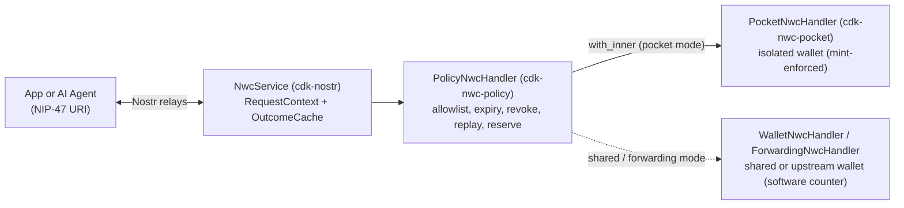

# cdk-nwc-policy

By [welliv](https://nostr.at/npub1626pdpr8gw0s86m7pccta9qj6k3f6pg243maccx78h9e730ervrstr3hde)

Give an AI agent or app a [Nostr Wallet Connect](https://github.com/nostr-protocol/nips/blob/master/47.md) (NIP-47) link to your Cashu wallet, and that string becomes a bearer credential: whoever holds it can ask the wallet to pay. Most NWC setups guard your whole balance with a counter in front of one shared wallet—which only works until a bug, race condition, or dropped relay reply lets a link reach everything else.

**Don't count the money—separate it. Let the mint enforce the limit.**

In this build, **pockets** (`cdk-nwc-pocket`) isolate the money so the mint enforces how much a link can lose, while **`cdk-nwc-policy`** enforces the control plane in front: method allowlists, expiry, immediate `UNAUTHORIZED` revocation, `3,600s` Nostr event-ID replay protection, and—when you explicitly opt into shared-balance or upstream-forwarding mode—reserve/commit/release budgets over a shared wallet.

---

## The 30-second explanation

- **Control plane over any `NwcRequestHandler`:** `PolicyNwcHandler` checks client key, revocation, expiry, allowed methods, and replay protection before forwarding a request.
- **Pairs with pockets (`with_inner`):** `ConnectionManager::start_with_inner` runs each connection's policy rules in front of its own `PocketNwcHandler`, so the mint caps spending even if a budget is unset or software fails.
- **Shared-balance fallback:** Without pockets, `PolicyNwcHandler` acts as a fail-closed software counter (`budget_msat`, `max_single_payment_msat`, `max_fee_reserve_msat`) over a single shared wallet.
- **Fail-closed on ambiguous payments:** Reservations only release on `INSUFFICIENT_BALANCE` or `QUOTA_EXCEEDED` (proof nothing was dispatched). Ambiguous errors (`PAYMENT_FAILED`, `INTERNAL`, `OTHER`) stay charged (`300s` TTL).
- **Always-on revocation:** `ConnectionManager` keeps revoked and expired services listening so callers receive `UNAUTHORIZED` instead of hanging until timeout.

---

## Architecture



---

## Live rogue-agent proof (Mutinynet, 26 Nov 2026)

In the live Mutinynet proof (`https://cashu.mutinynet.com`, `Nutshell/0.21.0`, `input_fee_ppk = 100`) over public Nostr relays (`wss://relay.primal.net`, `wss://nostr.mom`, `wss://relay.damus.io`):

- Main wallet funded with **53 sat** (`54 sat` paid incl. `1 sat` LN fee); **30 sat** pocket funded (`32 sat` cost), leaving **21 sat** in main.
- Rogue agent paid `3 × 7 sat` (`+ 6 sat` measured fees = **27 sat** total), hit a dropped relay reply in Round 3 (`OTHER "relay not connected"`—which motivated `OutcomeCache` + 4-step publish retry in `cdk-nostr`), and was cut off in Round 4 with `INSUFFICIENT_BALANCE`.
- Whole-wallet drain (`21 sat`) was refused; **main stayed 21 → 21 sat (untouched)**; revoke swept **2 sat** home; loot swap returned **19 sat** (`42 sat` main at end; **17 sat** net cost after returning `35 + 2 sat`).

And in CLI pocket mode driven by a third-party client (Alby SDK `NWCClient`) with `PolicyNwcHandler::with_inner` over a pocket (`--pocket-sats 30 --refill-cap-sats 40`): six `7 sat` payments succeeded, the next six were refused with `QUOTA_EXCEEDED`, and `revoke` swept `3 sat` home while immediately answering subsequent requests with `UNAUTHORIZED`.

---

## Software counter vs. Cashu pocket

| Property | `cdk-nwc-policy` alone (shared / upstream) | `cdk-nwc-policy` + `cdk-nwc-pocket` (`--pocket`) |
|---|---|---|
| **Where the limit lives** | Counters in `nwc-policy.json` | **Isolated pocket proofs enforced by the mint** |
| **Prepaid-card guarantee** | No — software counter guards whole main balance | **Yes** — max loss is bounded by pocket balance |
| **`get_balance` view** | Whole main (or upstream) wallet balance | **Pocket balance only** |
| **Revoke effect** | Answers `UNAUTHORIZED` | Answers `UNAUTHORIZED` **and swaps proofs back to main** |
| **When to use** | Read-only links, upstream forwarding, or explicit shared opt-in | **Any spendable app or AI agent link on a local CDK wallet** |

---

## Quickstart

### Wrapping per-connection pockets (`with_inner` / `start_with_inner`)

```rust,no_run
use std::sync::Arc;
use cdk_nostr::nwc::NwcRequestHandler;
use cdk_nwc_policy::manager::ConnectionManager;
use cdk_nwc_policy::{BudgetPeriod, ConnectionPolicy};

# async fn example<H: NwcRequestHandler + Send + Sync + 'static>(
#     default_handler: Arc<H>,
#     pocket_handler: Arc<H>,
# ) -> Result<(), Box<dyn std::error::Error>> {
let mut manager = ConnectionManager::new("nwc-manager.json", "nwc-policy.json", default_handler)?;

let policy = ConnectionPolicy {
    id: String::new(),
    name: "agent".to_owned(),
    client_pubkey: String::new(),
    allowed_methods: vec!["get_info".into(), "get_balance".into(), "pay_invoice".into()],
    budget_msat: None, // pocket holds the spending limit
    budget_period: BudgetPeriod::Never,
    max_single_payment_msat: None,
    max_fee_reserve_msat: 100,
    fee_overage_msat: 0,
    expires_at: None,
    revoked: false,
    used_msat: 0,
    period_start_secs: 0,
};

let uri = manager.create_connection("agent".into(), vec!["wss://relay.primal.net".into()], policy)?;
let id = manager.list_connections_view().last().unwrap().id.clone();
manager.start_with_inner(&id, pocket_handler).await?;
# let _ = uri;
# Ok(())
# }
```

### Standalone policy wrapper (shared balance or upstream forwarding)

```rust,no_run
use std::sync::Arc;
use cdk_nostr::nwc::{NwcRequestHandler, NwcService, NwcServiceConfig};
use cdk_nwc_policy::PolicyNwcHandler;
use tokio_util::sync::CancellationToken;

# async fn example<H: NwcRequestHandler + Send + Sync + 'static>(
#     wallet_handler: Arc<H>,
#     config: NwcServiceConfig,
# ) -> Result<(), Box<dyn std::error::Error>> {
let handler = PolicyNwcHandler::new("nwc-policy.json", wallet_handler)?;
let service = NwcService::new(config)?;
service.run(Arc::new(handler), CancellationToken::new()).await?;
# Ok(())
# }
```

---

## Honest costs and limits

- **`nwc-policy.json` holds counters, not an audit log.** It tracks `used_msat`, `fee_overage_msat`, open `reservations` (`300s` TTL), and pruned `seen_events` (`3,600s` window). Per-payment history lives in each CDK wallet's SQLite database (`lookup_invoice` / `list_transactions`).
- **Prepaid-card guarantee requires `cdk-nwc-pocket`.** Without pockets, `PolicyNwcHandler` is a software counter over a shared wallet.
- **`sat` unit only in local CDK wallets; no sub-sat msat.** `WalletNwcHandler` rejects `msat % 1000 != 0` and amountless invoices; `make_invoice` rejects `description_hash` and `expiry`; same-mint internal melts return `preimage: ""`.
- **No `get_budget` over NIP-47.** `nostr` `0.45` cannot parse `get_budget`.
- **Ambiguous failures consume budget.** If a payment fails with `PaymentFailed`, `Internal`, or `Other`, the reservation stays charged (`300s` TTL) because the payment may have succeeded on-mint or over Lightning.
- **No replay removal on failure.** A failed request must be retried with a fresh Nostr event ID (the same event ID is rejected as `Replayed` by policy, or answered from `OutcomeCache` at the relay layer).
- **Single-process serving by default.** `ConnectionManager` runs in one process; host clock integrity is assumed (`created_at` skew tolerance `300s`).

---

## Deep details

- **Fail-closed storage:** Exclusive sidecar `.policy.lock` / `.manager.lock`, `0600` file permissions, atomic write-before-memory-swap, corrupt-JSON and duplicate-key rejection on load.
- **Invoice-authoritative amounts:** `pay_invoice_with_context` decodes the BOLT11 invoice amount, rejects amountless invoices and mismatched optional `request.amount`, and reserves `invoice_msat + max_fee_reserve_msat`.
- **Period rollover:** `Daily` (`86,400s`), `Weekly` (`604,800s`), `Monthly` (fixed `30d` / `2,592,000s`), `Yearly` (fixed `365d` / `31,536,000s`) measured from the first request after the previous period ended. Stale reservations expire inside their original period before rollover.
- **Filtered `get_info`:** `PolicyNwcHandler` filters advertised `methods` per connection to match `allowed_methods`, and `NwcService` filters kind `13194` info events per link.

### Tests

```bash
cargo test -p cdk-nwc-policy
cargo test -p cdk-integration-tests --test nwc_policy_e2e
cargo test -p cdk-integration-tests --test nwc_policy_claim
```

39 unit tests across `policy_store` (14), `policy_handler` (9), `regressions` (11), and `manager` (5), plus integration tests in `cdk-integration-tests` (`nwc_policy_e2e` (4), `nwc_policy_claim` (2), `nwc_pocket` (8)).

## License

`Apache-2.0 OR MIT`, at your option, matching CDK.
